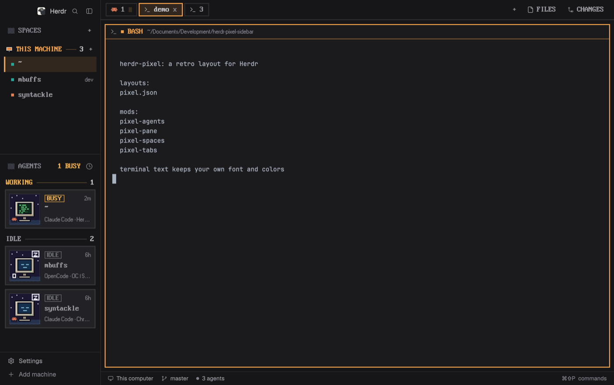

# Pixel: a retro layout for Herdr

A retro pixel-art layout for the [Herdr](https://herdr.dev) app. It uses bitmap-font headings and turns each agent into a card with a tiny scene that shows its status (sleeping, busy, done or needs you). Tabs and terminal frames are square, and the focused one is orange. Terminal text keeps your own font and colors.



## Install

Ask your agent:

> Add the Herdr layout from https://github.com/&lt;you&gt;/herdr-pixel-sidebar

Or copy the files yourself:

```sh
cp layouts/pixel.json ~/.config/herdr-app/layouts/
cp -R mods/pixel-spaces mods/pixel-agents mods/pixel-tabs mods/pixel-pane ~/.config/herdr-app/mods/
for m in pixel-spaces pixel-agents pixel-tabs pixel-pane; do herdr-app check ~/.config/herdr-app/mods/$m; done
herdr-app do layout.switch --name pixel
```

`ctrl-shift-l` switches back to your previous layout. Delete the copied layout file and four mod folders to remove it.

## Customize

- **Accent color:** `ORANGE` at the top of both `mods/*/main.js`.
- **Scenes:** `mods/pixel-agents/art/*.svg`, 32×32 pixel art.
- **How the spaces/agents split the height:** the `weight` values of the `spaces` and `agents` blocks in `layouts/pixel.json`.

[`RECIPE.md`](RECIPE.md) describes every detail, so an agent can rebuild the layout from scratch if these files stop matching your Herdr version.

## Credits and licenses

- The `main.js` of each `mods/pixel-*` folder is a modified copy of Herdr's shipped `spaces`, `agents`,
  `tabs` and `pane` mods, and `layouts/pixel.json` of its `main` layout (Herdr 0.1.14, Apache License 2.0;
  see [`LICENSE`](LICENSE)). The changes restyle how they draw: pixel headings, per-machine space headings,
  agent cards, square tabs and pane frames. The icons in `pixel-tabs` and `pixel-pane` are Herdr's, unchanged. The code and layout in this repo are under the same license.
- The pixel art is original to this repo.
- Fonts, unchanged, with their license files in `mods/pixel-spaces/fonts/`:
  - **PxPlus IBM VGA 8x16** by VileR (int10h.org), CC BY-SA 4.0.
  - **Pixelated MS Sans Serif** by lou (FontStruct), CC BY-SA 3.0.
