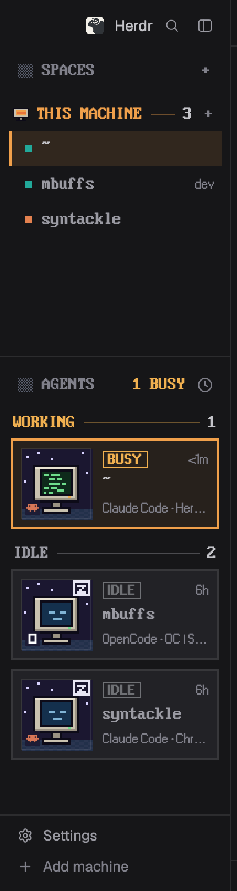

# Pixel Sidebar

A retro, pixel-art take on Herdr's main window. Everything outside the sidebar stays as in Herdr's `main` layout. Spaces are listed under a machine heading set in a VGA bitmap font. Agents become framed cards, each with a tiny pixel scene that shows the agent's status: a sleeping monitor, a screen of scrolling code with a blinking cursor, a smile, or a red "!".

## What you see

The left sidebar, top to bottom (default width 268px):

1. **Brand bar** (46px): Herdr's own `workspace-chrome` mod, unchanged.
2. **Spaces** (weight 2 of the remaining height, min 90px):
   - **Header row** (36px): a 14×12 dithered square (`#5a5f6e` checkerboard), then `SPACES` in `PxPlus IBM VGA 8x16` at 16px in the theme's `dim` color. A pixel `+` sits on the right and turns `#f0a04b` on hover.
   - **Machine heading** (30px, 6px above): a 14×12 pixel monitor icon for this computer, or a pixel server icon for remote machines. Then the machine name in upper case (`THIS MACHINE` for this one) in `#f0a04b`, a 1px rule in `#f0a04b66` that stretches to the edge, the space count in `foreground`, and a `+`. Unreachable machines draw the heading in `dim` and show their state instead of the count. The heading shows even when there is only one machine.
   - **Space rows** (32px; 28px for worktrees): a 6×6 square in the space's stored color, then the name in the VGA font at 16px (`foreground` when active, `muted` otherwise). The git branch and ahead/behind sit right-aligned in `Pixelated MS Sans Serif` at 11px. The active row has a 3px `#f0a04b` left border and a `#f0a04b1f` fill.
3. **Agents** (weight 3, top border in `border`):
   - **Header** (41px): the dithered square, `AGENTS` in the VGA font in `dim`, then `N BUSY` (`working` color when N > 0, else `dim`), then the sort icon.
   - **Group headings**: Working, Idle, Done, Needs you (priority sort) or space names (grouped sort). Each is set like the machine heading: the label in the status color (Idle in `muted`, space groups in `#f0a04b`), a rule, and the count.
   - **Agent cards**: 2px border (`border`, or `#f0a04b` with a `#f0a04b14` fill when focused; `input` on hover), 7px padding, 10px gap, 4px vertical margin, `surface` background.
     - Left: a 64×64 pixel scene with a 1px `border` frame, and the agent's program icon (11px) in the bottom-left corner on a `#1b1730cc` chip.
     - Right, three lines:
       1. A status badge: 1px border plus text in the status color, MS Sans Serif Bold 11px, reading `IDLE`, `BUSY`, `DONE` or `NEEDS YOU`. The time since the agent's last state change is on the right, or a pin button on hover.
       2. The space name in the VGA font at 16px.
       3. `program · title` in MS Sans Serif 11px, `dim`, truncated.
4. **Footer** (69px): `workspace-chrome` with `{footer: true}`, unchanged.

The scenes are 32×32 pixel art drawn at 2× scale: a beige CRT on a navy starfield (`#1b1730`) over a striped floor.

| Status | Screen | Bubble |
|---|---|---|
| idle | `#14304d`, closed eyes | white "z" |
| working | `#0e2a1b`, green code lines, plus a blinking cursor | none |
| done | `#122a3c`, green smile | green check |
| blocked | `#3a1119`, red "!" | red "?" |

## How it behaves

- **Statuses.**
  - **Working:** the BUSY badge in `working`, the code scene, and a 6×2 green cursor that blinks. The blink is a native `.loop("opacity", {from: 0.05, to: 1, period: 900})` at (32, 36) in the scene, not a timer.
  - **Blocked:** NEEDS YOU in `blocked` and the "!" scene. The space row also shows a red `!` after its name.
  - **Done:** DONE in `done` and the smile scene. The space row shows a `*`.
  - **Idle:** IDLE in `idle` and the sleeping scene. The name turns `muted` unless the agent is focused.
- **Clicks.**
  - A space row selects it. Right-click opens the space menu, and dragging reorders spaces within a machine.
  - A machine heading folds or unfolds its spaces, and its `+` makes a new space there.
  - A card focuses that agent's pane. Hovering a card swaps the time for a pin button.
  - A group heading folds that group, and the count then reads `N ›`.
- **Unchanged from Herdr's mods:** sub-agents (tree rows under their parent), pinning, the sort menu, git refreshes, worktree nesting and machine reconnects.
- **Narrow sidebar:** below 160px wide (`ctrl-shift-b` folds it), both mods fall back to Herdr's compact rail.

## Built from

- `layouts/pixel.json`: a clone of Herdr's `main`. The `spaces` and `agents` blocks point to `pixel-spaces` (weight 2) and `pixel-agents` (weight 3). Every other block uses Herdr's shipped mods: `workspace-chrome`, `tabs`, `files`, `changes` and `workspace-status`.
- `mods/pixel-spaces`: a clone of Herdr's `spaces` mod.
  - Adds `pixelHeading()` and a pixel heading for each machine, and restyles `row()` and the header.
  - Calls `spaces`, `machines`, `panes`, `run` (`space.select`, `space.move`, `space.new`), `openOverlay` (the menu), `exec` (git), `hc` (`machine ls/rm/add`), `watchFolder`, `shared` and `setShared` (`space.colors`).
  - Ships the fonts in `fonts/`, which the other mod uses too.
- `mods/pixel-agents`: a clone of Herdr's `agents` mod.
  - Replaces the expanded row with the card and the group header with `pixelHeading()`, and adds the `N BUSY` header.
  - Calls `agents`, `terminals`, `panes`, `focused`, `spaces`, `run` (`pane.focus`, `terminal.pin`, `terminal.peek`), `setAgentOrder`, `openOverlay` and `closeOverlay`.
- Art: original SVGs made of 1×1 `rect`s with `shape-rendering="crispEdges"`.
  - `pixel-agents/art/{idle,working,done,blocked}.svg` are 32×32.
  - `dither.svg`, `monitor.svg` and `server.svg` are 12×10.
- Fonts:
  - `PxPlus IBM VGA 8x16` (VileR, CC BY-SA 4.0).
  - `Pixelated MS Sans Serif` Regular and Bold (lou, CC BY-SA 3.0).
  - Herdr ships both in its Win98 mod. Copies and licenses are in `mods/pixel-spaces/fonts/`.
- No network access and no programs beyond what Herdr's own `spaces` mod runs (`git` and `hc machine`).

## Watch out

- **Font sizes:** the VGA font is crisp only at 16px (its native cell). Smaller sizes blur, so small print uses MS Sans Serif at 11px instead.
- **Shared fonts:** `pixel-agents` has no `fonts/` folder of its own and relies on `pixel-spaces/fonts`. Fonts load at start and on the next look change. Switching to the layout loads them, but if text renders in a fallback font, switch layouts once.
- **Cursor position:** the cursor's position (32, 36) is tied to the art's 2× scale. Redrawing `working.svg` or changing the 64px scene size moves it off the screen.
- **Shipped icons:** both mods still reference shipped icons in `mods/workspace-chrome/` (plus, chevrons, pin, sort, spinner). Those ship with Herdr, but renaming them would break these mods.
- **Heading space:** long machine names truncate at 150px, so the rule can shrink to its 8px minimum.
- **Colors:** colors come from the theme, apart from the fixed accent `#f0a04b` and the art palette. Light themes work, but the scenes stay dark.

## Done when

- `herdr-app check mods/pixel-spaces` and `herdr-app check mods/pixel-agents` both pass.
- `herdr-app do layout.switch --name pixel` shows `SPACES` and `AGENTS` in the VGA bitmap font, not a smooth fallback font.
- With one machine, a `THIS MACHINE ─── N` heading appears and N equals the number of spaces.
- Clicking another space moves the orange left bar to it.
- An agent that is working shows a BUSY card with green code and a blinking cursor. When it finishes in another space, the card becomes DONE with a smile.
- Clicking a card focuses that agent's pane and gives the card the orange border.
- `herdr-app status` lists no errors.
